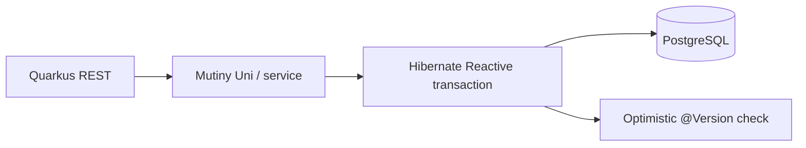

# Quarkus Reactive Inventory | Mutiny + Hibernate Reactive

**Java 21 · Quarkus · Mutiny `Uni` · PostgreSQL reactive driver · Optimistic locking**

Reserve inventory asynchronously without blocking request threads. This demo emphasizes **correctness under concurrency**, not just a reactive `Hello World`.

## Architecture



## Run

```bash
docker compose up -d
mvn quarkus:dev
```

```bash
curl -X POST http://localhost:8080/api/inventory -H 'Content-Type: application/json' \
  -d '{"sku":"BOOK-01","available":25}'
curl -X POST http://localhost:8080/api/inventory/BOOK-01/reservations \
  -H 'Content-Type: application/json' -d '{"quantity":4}'
curl http://localhost:8080/api/inventory/BOOK-01
```

`mvn verify` runs domain unit tests. The Quarkus dev profile updates the local schema; **schema update is disabled for production**.

## Engineering decisions

- Async `Uni` throughout REST + persistence; reactive transactions use `@WithTransaction`, **not** blocking JPA `@Transactional`.
- `@Version` optimistic locking rejects concurrent writes rather than silently losing one. A conflict can be retried with backoff by the caller; it is not blindly retried here.
- Domain invariant: `available + reserved` remains constant per item after reservations.
- API validates inputs and maps insufficient stock/concurrent updates to `409`.
- Unique SKU constraint prevents duplicate rows. Handling a simultaneous duplicate create with a well-formed 409 is a sensible follow-up.

## Limits

Demo assumes one PostgreSQL instance and has no authentication or reservations expiry. Production needs migrations (Flyway/Liquibase), tenant isolation, audit trails, load tests, connection pool sizing, 409 mapping for all persistence lock exceptions, and proper security.

_Independent portfolio demonstration. Not affiliated with any employer or customer._
